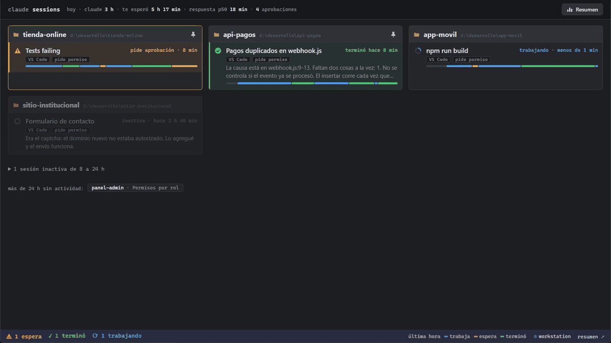
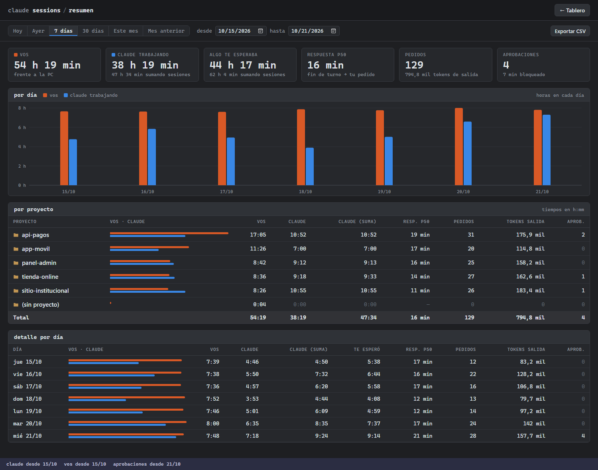

# tablero-claude-code

Tablero local con el estado de todas tus sesiones de Claude Code, en VS Code o en la terminal:
cuáles están trabajando, cuáles te piden una aprobación y cuáles terminaron y te están esperando.

Con varias sesiones en paralelo, suele pasar que una lleve media hora esperando tu aprobación sin
que te enteres. Además, tenés que estar recordando cuál ventana era de cuál proyecto. El tablero te
muestra de un vistazo cuál te necesita y con un clic la traés al frente. Ideal para tener abierto en
un segundo monitor, por ejemplo.



> **Proyecto no relacionado con Anthropic.** No está afiliado a Anthropic ni tiene su respaldo. Lee archivos internos
> de Claude Code que pueden cambiar con cualquier actualización; el tablero avisa cuando detecta una
> versión con la que no se probó.

## Qué hace

- **Una tarjeta por proyecto**. Muestra una tarjeta por proyecto con filas por cada sesión del mismo, 
  con su estado, el título, el último mensaje de Claude y hace cuánto cambió. Arriba va lo que necesita atención.
- **La última hora de cada sesión**, en una línea de tiempo fina: cuándo trabajó, cuándo esperó una
  aprobación y cuándo terminó, aunque no estuvieras mirando. Al pasar el mouse, muestra el minuto a minuto.
- **Click en una tarjeta**: trae al frente la ventana de VS Code o terminal. Si es de VS Code, además abre la pestaña 
  de la sesión que te espera.
- **Varias PCs**: cada PC ve las sesiones de todas, y cada máquina tiene su color (una franja arriba
  de la tarjeta y su nombre). Si una deja de responder, sus tarjetas no desaparecen pero quedan en gris.
- **Tarjetas fijas**: fijá los proyectos que quieras para que no se muevan en el tablero y saber siempre dónde mirar.
- **Métricas**: tu tiempo y el de Claude por proyecto y por día, cuánto te esperaron las sesiones,
  aprobaciones y tokens. Exportables a CSV para estadísticas, planificar, cotizar, ...
  
- **Sin hooks, sin dependencias, sin telemetría.** Solo lee archivos locales: no toca la
  configuración de Claude Code ni manda nada a internet.

## Requisitos

- **Windows** (por ahora; ver [cómo portarlo](docs/como-funciona.md#otros-sistemas)). Probado en
  Windows 11 con Claude Code 2.1.283 a 2.1.306.
- **Node.js 20** o superior.
- **Claude Code**, en la extensión de VS Code o en la terminal.
- Para las sesiones de VS Code, el comando `code` en el PATH (viene así por defecto): con él, el
  clic abre la pestaña de la sesión.

## Instalación

```
git clone https://github.com/Ingalca/tablero-claude-code.git
cd tablero-claude-code
powershell -ExecutionPolicy Bypass -File scripts\instalar-inicio.ps1
```

El script deja el agente arrancando solo al iniciar sesión en Windows, sin ventana, y lo arranca en
ese momento. Después abrí **http://localhost:4590**.

Para quitarlo (detiene el agente y saca el arranque automático):

```
powershell -ExecutionPolicy Bypass -File scripts\quitar-inicio.ps1
```

> **Con varias PCs**, las redes de todas tienen que estar como **Privada** y con la detección de
> redes activada: en una red Pública, Windows no deja que se vean. Con una repetidora o una red mesh,
> Windows crea perfiles nuevos que vuelven a quedar en Pública. Todo está en
> [docs/varias-pcs.md](docs/varias-pcs.md), con scripts para el firewall y los perfiles de red.

¿Querés verlo antes de instalarlo? `npm run demo` levanta un tablero con datos inventados en
http://localhost:4599.

## Uso

- **Click en una tarjeta**: la sesión más urgente. **Click en una fila**: esa sesión. La primera
  vez, VS Code pregunta *"Allow 'Claude Code' extension to open this URI?"*: marcá *"Do not ask me
  again for this extension"* y aceptá. Las sesiones de la terminal (PowerShell, Windows Terminal,
  Git Bash) también se traen al frente: su ventana, aunque no necesariamente la pestaña exacta.
- **Etiquetas** bajo el título: desde dónde corre la sesión (*VS Code*, *Windows Terminal*,
  *Git Bash*, *consola*) y su modo de permisos (*auto*, *acepta ediciones*, *plan*, *pide
  permiso*). El modo es el de tu último prompt: si lo cambiás sin escribir nada, se actualiza con
  el siguiente prompt.
- **Pin** (aparece al pasar el mouse): fija la tarjeta. Las fijas se reordenan arrastrándolas.
- **Estados**: *trabajando*, *esperando* (aprobación o pregunta), *terminó* (hasta que hacés click
  o pasa un rato) e *inactiva*. Las inactivas de varias horas dejan de mostrarse como tarjetas y van 
  a un desplegable, y las de más de un día, a una lista al pie.
- **Barra de estado** (abajo): cuántas sesiones esperan, terminaron o trabajan, las máquinas, y un
  ⚠ si alguna sesión corre una versión de Claude Code con la que el tablero no se probó.
- **Resumen** (botón arriba a la derecha): métricas por rango de fechas, por día, o por hora en
  "Hoy" y "Ayer", filtrables por máquina.

## Configuración

`config.json` se crea la primera vez. Los campos principales:

| Campo | Default | Qué es |
|---|---|---|
| `maquina` | nombre de la PC | El nombre que se ve en las tarjetas |
| `host` | `127.0.0.1` | Dónde escucha: solo esta PC. Con varias PCs, `0.0.0.0` |
| `peers` | `[]` | Las otras PCs, por nombre: `["notebook"]`. Ver [varias PCs](docs/varias-pcs.md) |
| `token` | al azar | El mismo en todas las PCs |
| `puerto` | `4590` | |
| `minutosTrasVer` | `5` | Minutos tras el click para que "terminó" pase a inactiva |
| `minutosSinVer` | `60` | Minutos tras terminar para que pase a inactiva aunque no hagas click |
| `horasInactivasVisibles` | `8` | Hasta acá las inactivas van en la grilla; después, al desplegable |
| `horasInactivasPlegadas` | `24` | Después de esto, solo el nombre en la lista al pie |
| `registrarActividad` | `false` | Activa la medición de **tu tiempo** (ver abajo) |
| `minutosInactividad` | `5` | Tu tiempo: sin teclado ni mouse por más de esto, el minuto no cuenta |
| `programasQueSuman` | `[]` | Tu tiempo: programas que, además de VS Code, cuentan como trabajo en el proyecto. Ej. `["firefox", "windowsterminal"]` |
| `minutosArrastre` | `10` | Tu tiempo: un programa de esa lista suma al último proyecto si fue hace menos de esto |

Después de cambiarlo, reiniciá el agente: volvé a correr `instalar-inicio.ps1`.

### Tu tiempo es opcional

Para medir cuánto tiempo le dedicás a cada proyecto, el agente registra cada 15 segundos si usaste
el teclado o el mouse y qué programa tenés al frente. Guarda el nombre del proyecto o del programa,
nunca el título de la ventana, y todo queda en `datos\`, en tu PC. Viene **apagado**: activalo con
`"registrarActividad": true`.

Cuenta solo tiempo en proyectos: VS Code con la carpeta del proyecto, y los pedidos a Claude desde
la terminal. Cualquier otro programa no suma, salvo los que agregues en `programasQueSuman`. La
metodología está en [docs/metricas.md](docs/metricas.md).

## Documentación

- [Varias PCs](docs/varias-pcs.md): cómo sumar otra PC, por la red local o con Tailscale.
- [Cómo funciona](docs/como-funciona.md): de dónde sale cada estado y cómo trae las ventanas al frente.
- [Métricas](docs/metricas.md): qué mide cada número y con qué criterio.
- [API del agente](docs/api.md).
- [Seguridad](SECURITY.md): qué protege el diseño y qué no.

## Desarrollo

- `npm test`: las pruebas (con `node:test`, sin dependencias).
- `npm run demo`: el tablero con datos inventados, en http://localhost:4599.

## Licencia

[MIT](LICENSE).

---

<a href="https://ingalca.com"></a>
Hecho por **[Ingalca](https://ingalca.com)**.
